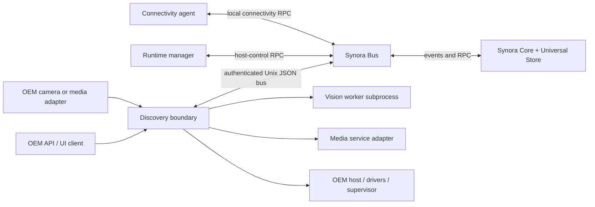

# Current and proposed process map

## Current process inventory

The following are OS processes when launched. A Go package/domain is not
automatically a process.

| Process / entrypoint | Current packaging | IPC and hosted responsibilities | Startup / failure behavior and dependencies |
| --- | --- | --- | --- |
| `synora-bus` (`cmd/synora-bus`) | `synora-bus.service`; `synora` user | Authenticated JSON messages over `/run/synora/bus.sock`; queues are local to process. | First in documented Makefile start order; `Restart=always`. Linux Unix socket directory and ACLs. |
| `synora-runtime-manager` | `synora-runtime-manager.service`; root | Bus RPC/command handler; service/runtime operations from `internal/manager`. | Requires bus; `Restart=always`; root host-control requirement is a privilege concentration. |
| `synora-core` | `synora-core.service`; `synora` user | Bus event consumer, cognitive pipeline, Safety Gate, Universal Store writer. | Requires bus; `Restart=always`; persistent store and optional model bundle. |
| `synora-discovery` | `synora-discovery.service`; root | External API/HTTPS, SSE, vision ingress, worker manager, device/runtime registry, MediaMTX and host-network composition. | Requires bus; `Restart=always`; runs privileged host networking. This is a large multi-domain failure boundary. |
| `synora-connect run` | `synora-connect.service`; `synora` user | Local connectivity agent, local state, bus RPC. | Requires bus/network-online; `Restart=on-failure`; outbound enrollment/remote link is not implemented. |
| MediaMTX | `mediamtx.service`; `synora` user | RTSP/media process and HTTP control API used by Discovery. | Starts after network target; `Restart=always`; external binary/config, local media resources. |
| Vision worker (`services/vision-worker/worker.py`) | Not a systemd unit; started by Discovery through `internal/vision` | JSON protocol over a Unix socket; vision inference and clip processing; does not own global business state. | Spawn/restart/health behavior is owned by the Vision package and injected into its runtime; depends on Python, pinned packages, optional model/RKNN runtime and filesystem resources. |
| `synora-api` (`cmd/synora-api`) | Built by Makefile; no shipped unit | Standalone REST/WebSocket server and static frontend. | No active systemd startup dependency found. Relationship to Discovery's own API is unresolved. |
| `synora-camera`, `synora-camera-mock` | CMake developer/prototype binaries only | Camera abstraction; deterministic simulation; mock can upload caller-supplied fixture via signed HTTP ingress. | Not installed or supervised as production process. No physical camera adapter is present. |

Other `cmd/*` programs are administrative CLIs (`synora-bootstrap-config`,
`synora-token-rotate`, `synora-network-config`, version/health tools) or test,
replay, qualification and benchmark runners. They are not long-running service
processes.

M1.2 changed logical code ownership only: the worker lifecycle and protocol
implementation now live in `internal/vision`. The OS process inventory and
startup boundaries above remain unchanged. See
[`11-module-boundaries.md`](11-module-boundaries.md) for the module/process
distinction.

## Observed ordering, restart, and resources

Makefile start order is bus → runtime manager → Core → Discovery → connect →
MediaMTX; stop order reverses it. Unit dependencies explicitly require the bus
for runtime manager/Core/Discovery/connect. Restart policy is `always` for
bus/Core/Discovery/runtime-manager/MediaMTX and `on-failure` for connect.
Units set 15-second stop timeout, bounded file descriptors/tasks and umask
`0077`; connect and MediaMTX have stronger filesystem/device sandboxing than
the root services. Runtime manager and Discovery are root in the shipped units;
this is a known privilege boundary to revisit.

No validated per-process CPU/memory sizing or vendor-specific resource budget
is encoded in the units. Vision model execution can dominate CPU/NPU/memory and
media I/O; model runtime, model files and device nodes are host dependencies.
Failure isolation is at process boundaries, but the Discovery process hosts
several integration domains.

## Proposed OEM process architecture

Preserve the six established OS process boundaries initially. Keep module
composition separate from process choice:

For the next architecture stage, make API hosting an explicit choice (Discovery
embedded or standalone `synora-api`), document a supported privilege profile,
and define platform ports for service supervision, networking, storage,
media and accelerator access. Do not split Discovery or Core into more
processes before those ports exist and source-of-truth boundaries are tested.
