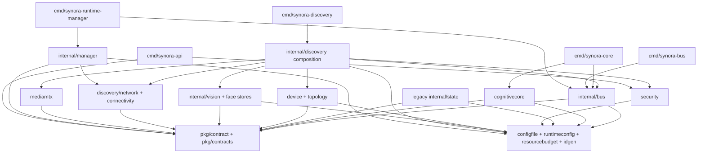
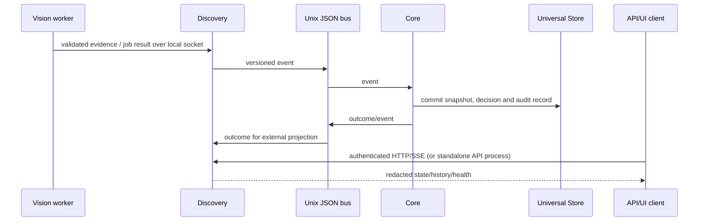

# Dependency graph

## Go package and process graph

The module is single-root and the current imports resolve as a directed graph.
`pkg/contract` is the lowest-level shared domain schema. The graph below groups
packages to keep it readable; package paths remain authoritative in source.

`internal/discovery` is the integration composition root and has the broadest
internal dependency fan-in. Keep this direction while extracting ports; avoid
moving shared policy into the API, UI, or a hardware adapter. `internal/state`
is a separate legacy store and is not the active Core writer. The UI is a
client of HTTP/WebSocket APIs; it is not imported by Go services.

## Runtime process/data flow

The active authority contract is documented in `docs/v1-store-authority.md`:
Core owns writes to Universal Store; Discovery is the external boundary and
read projection; Vision supplies validated observations, not commands.

## External dependency layers

| Layer | Current dependencies |
| --- | --- |
| Go standard runtime | Linux process, filesystem, sockets, signals and HTTP/TLS. |
| Go modules | UUID, Gorilla WebSocket, `x/crypto`, YAML; indirect `x/net` and `x/sync`. Paho MQTT is declared but has no source import. |
| Python worker | Python 3, OpenCV headless, NumPy, SciPy; on ARM64, RKNN Toolkit Lite 2 and matching Rockchip runtime/driver/device permissions. |
| Media pipeline | Separate MediaMTX binary/config; ffprobe/curl/openssl for camera mock workflow. |
| Network host manager | hostapd, dnsmasq, Linux bridge/firewall utilities and privileged network APIs. These are invoked by command adapters. |
| UI | Node/npm; React, TypeScript, Vite and Lucide packages from `package-lock.json`. |
| Native camera mock | CMake, C++20 toolchain, pthread; fixture upload path additionally expects ffprobe, curl and openssl. |

There is no SQL database or message broker dependency in the active Go bus
path. Persistence is file-based JSON/JSONL. `deployments/mosquitto` and the
declared Paho module are not evidence that MQTT is active.

M1.2 moved the Vision worker package to `internal/vision`. The logical module
graph, package ownership map, and enforced import restrictions are documented
in [`12-module-dependency-matrix.md`](12-module-dependency-matrix.md). The
network adapter receives station data through an injected source supplied by
the Integration composition root; it no longer imports the device registry.
