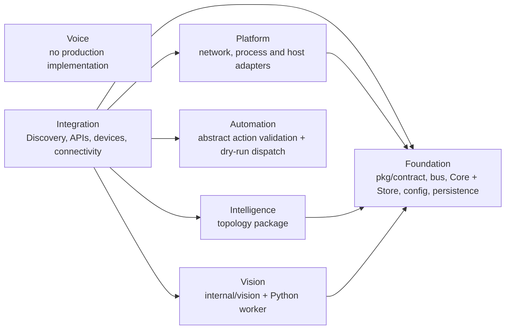

# M1.2 module boundaries

This document describes the code after M1.2's first active extraction. A
single Go module remains in use. Logical descriptors live in `modules/` and
are checked against the real Go import graph by `make architecture-check`.

## Current implementation

`internal/vision` now owns the Go worker protocol client, queue, segment
runtime and process lifecycle policy. Discovery and ingress consume that
package through Go calls; Vision no longer sits under Discovery's package
tree. `Runtime` consumes the small `WorkerLifecycle` interface so lifecycle
behavior can be supplied by a fake in tests. Existing worker process creation
still uses the injectable `ProcessExecutor` and preserves the current Unix
socket protocol.

| Logical module | Current code ownership | Current maturity |
| --- | --- | --- |
| Foundation | Shared contracts, bus, configuration/persistence primitives, active Core and Universal Store, plus legacy `internal/state` | Implemented software; Core and cognition still share a package |
| Intelligence | Topology and resident configuration semantics in `internal/intelligence/topology` | Partial; cognitive snapshot/evidence work remains inside Foundation Core |
| Vision | `internal/vision`, Python worker, model and face dataset support | Partial; worker/model capability depends on selected runtime and qualification |
| Voice | No production package | Not implemented |
| Automation | `internal/automation` owns abstract action contracts and deterministic dry-run outcome policy; Core retains the cognitive safety gate and action ledger | Partial; no physical action adapter |
| Integration | Discovery composition/API/ingress, device registry, connectivity and security | Partial; Discovery remains a high fan-in composition root |
| Platform | Runtime manager, network operations, host health/version, MediaMTX adapter and bootstrap | Partial; current deployment assumes Linux/systemd and host utilities |

The ownership ledger is machine-readable in [`modules/manifest.json`](../../modules/manifest.json)
and [`modules/package-ownership.json`](../../modules/package-ownership.json).
The package ownership file must be updated whenever an internal Go package
moves to a different logical module.
The descriptors use `configuration_schema: null` where the repository has
configuration examples but no formal schema for that module.

## Target architecture

Keep one Go module while extracting Core's cognitive algorithms from its
authoritative store behind consumer-owned ports. Keep process supervision and
device/network protocols behind adapters. Add Voice source only when a real implementation exists; keep Automation policy in its
own package and device protocols behind adapters. Do not turn logical modules into separate
services by default.

## Not implemented

There is no dynamic module loader, per-module Go module, plugin ABI, external
Voice engine, physical Automation executor, or vendor camera adapter.
Descriptors express current boundaries and dependencies; they do not claim
runtime module discovery.
