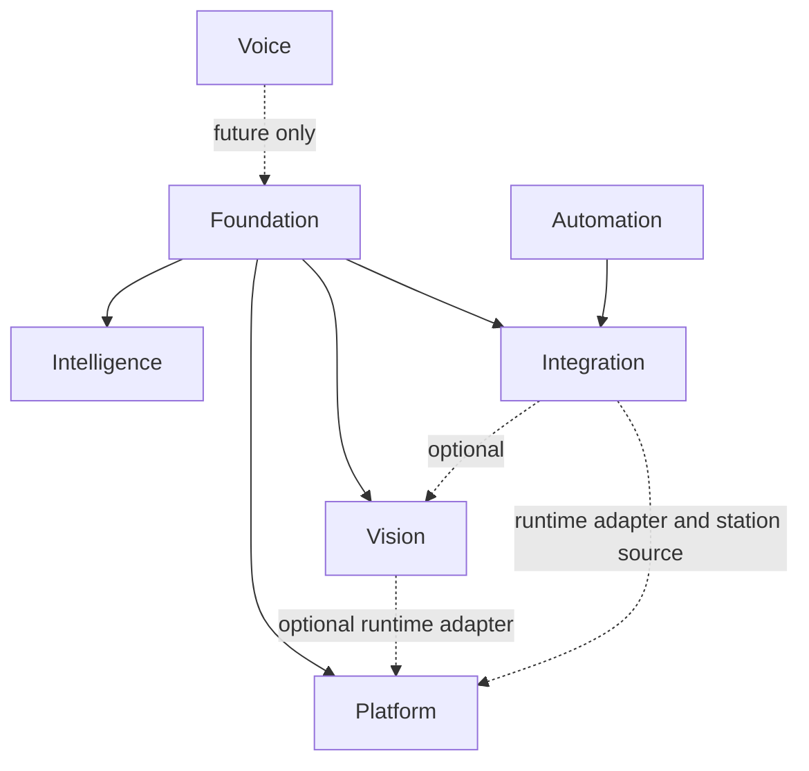

# M1.2 module dependency matrix

## Current implementation

The table shows declared logical dependencies. Optional means the current
module can be built without the optional capability but uses it in selected
composition paths. The actual package graph is checked from `go list`, not
inferred only from this table.

| Module | Required | Optional | Observed qualification |
| --- | --- | --- | --- |
| Foundation | — | — | `pkg/contract` is standard-library-only; Core owns active Universal Store writes |
| Intelligence | Foundation contracts | — | Topology imports Foundation config/contracts; cognitive runtime remains co-located in Core |
| Vision | Foundation contracts | Platform process/runtime facilities | `internal/vision` has no Intelligence or Discovery imports; protocol remains Unix-socket JSON |
| Voice | — | — | No implementation or Go packages |
| Automation | — | — | `internal/automation` validates abstract action requests and resolves controlled dry-run outcomes; Core retains its safety gate and durable action ledger |
| Integration | Foundation contracts and bus | Vision, Platform | Discovery composes bus, Vision, device, security and runtime services |
| Platform | Foundation | — | Network adapter receives an injected station source; Integration translates device config at composition time |

The descriptor graph is acyclic. The current Go package graph is also checked
for cycles. The architecture checker rejects Foundation imports of higher
domains, Intelligence imports of Vision/Integration/Platform, Vision imports
of Intelligence/Integration/Platform, Platform imports of functional or
Integration packages, and functional-module imports of Platform's runtime
manager.

## Target architecture

Keep Integration as the composition root. Automation now owns the abstract action contract and controlled dry-run
policy. Integration consumes that interface and retains bus/event translation;
physical device protocols remain outside Automation.

## Not implemented

The dependency checker does not claim that every dependency inversion is
complete. The Core package remains mixed and Discovery directly composes
several concrete adapters. These are explicit follow-up seams, not silent
exceptions to the target design.
