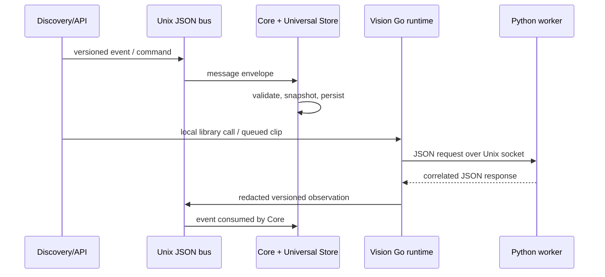

# M1.2 module communication map

## Current implementation

| Producer → consumer | Classification | Contract and transport | Synchronization / failure | Coupling and replaceability |
| --- | --- | --- | --- | --- |
| Go packages → Go packages | `DIRECT_LIBRARY_CALL` | Go exported types/functions; same process and Go module | Synchronous call; Go error/return value | Compile-time coupling; Vision's new package boundary remains replaceable at its injected lifecycle interface |
| Vision Runtime → Python worker | `REQUEST_RESPONSE` | Versioned newline-delimited JSON over Unix domain socket; hello handshake and request IDs | Synchronous, deadline bounded; malformed/degraded response rejects work; worker restart/backoff in manager | Medium transport coupling; protocol adapter replaceable while contract remains stable |
| Vision worker/clip path → Discovery → bus | `EVENT` | `synora.vision.evidence/v1` and other versioned `contract.Message` payloads over local bus | Asynchronous; bus reconnect, bounded queue, unavailable evidence on worker failure | Business meaning is versioned contract; Unix socket bus transport can be replaced behind bus API |
| Go services → internal bus | `EVENT`, `COMMAND`, `REQUEST_RESPONSE` | JSON messages with service ACL/HMAC over Unix socket | Async event delivery; request correlation/timeouts; reconnect and rejection behavior | Transport has a stable envelope; Core/Discovery retain semantic ownership |
| API client → Discovery or standalone API | `REQUEST_RESPONSE` | HTTP/HTTPS JSON; SSE for event stream; WebSocket on standalone API | Request scoped; auth and validation errors returned; client disconnect terminates stream | External interface; API surface replaceable behind shared contract/security boundary |
| Discovery → MediaMTX | `REQUEST_RESPONSE` | HTTP MediaMTX control API | Bounded HTTP request; errors returned to caller; external server lifecycle separate | Concrete reference adapter; replaceable behind path-control API |
| Runtime manager/network → host | `COMMAND` | `os/exec` calls to systemd/network utilities and local config files | Synchronous command execution; exit status/error; rollback/status paths vary by operation | High host coupling; replace with platform adapter per OS/supervisor |
| Tests/tools → files and fixtures | `FILE_EXCHANGE` | JSON/YAML manifests, model reports and synthetic fixtures | Explicit local read/write; validation failure stops operation | Test/operator boundary; not a production event bus |
| Go packages → shared in-memory state | `SHARED_STATE` | Injected structs, locks, snapshots and callbacks | In-process; mutex/atomic or caller ordering | Package-local unless exported; avoid passing mutable state across new module boundaries |

No MQTT application communication path was found. The declared Paho module and
Mosquitto configuration do not establish an active MQTT bridge. No production
voice worker or generic sensor protocol exists.

## Target architecture

Preserve current transports. Keep contracts independent of Unix sockets, HTTP,
OS, and hardware. Introduce no broker. Make each new module consume a narrow
interface or immutable contract rather than transport-specific structures.

## Not implemented

WebSocket does not appear in Discovery's shipped API composition; it belongs
to the standalone API. This code/deployment discrepancy is recorded here.
There is no MQTT, distributed execution, or module-to-module network RPC.
