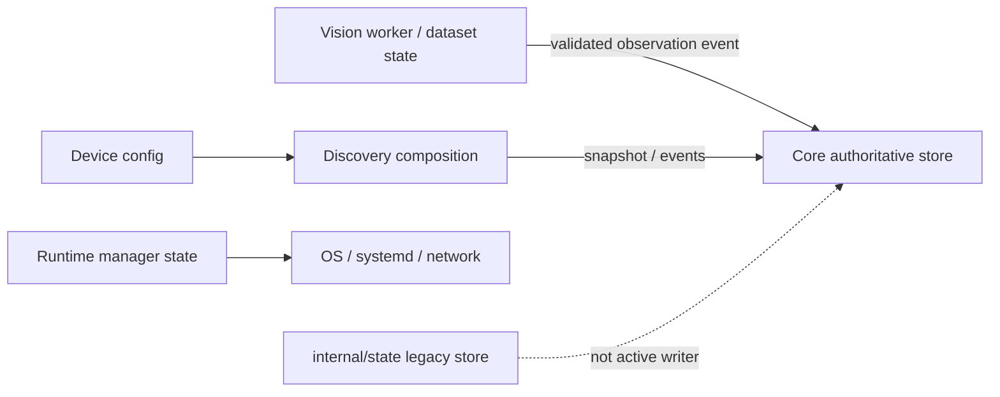

# M1.2 state ownership

## Current implementation

| Mutable state | Authoritative owner | Access path / persistence | Boundary finding |
| --- | --- | --- | --- |
| Universal Store and active system state | `internal/cognitivecore` Core | Core commit API; local WAL/snapshot/replay | Core is sole active business-store writer; no shared writable store handle across modules |
| Legacy event/state projections | `internal/state` | Legacy JSON/file persistence interfaces | Not the active Core store path; retained for compatibility and tests |
| Cognitive snapshot assembly and version validation | `internal/cognitivecore` | In-memory Core pipeline, committed through Universal Store | Mixed Foundation/Intelligence responsibility remains in one package |
| Topology and resident configuration | `internal/intelligence/topology` | Validated config loading; immutable values passed to callers | Configuration is authoritative; no sensor-derived localization is claimed |
| Vision worker lifecycle and crash/backoff state | `internal/vision` WorkerManager | Mutex-protected process snapshot; process itself is external | Owned by Vision lifecycle package; Discovery reads a snapshot |
| Vision clip queue and episode/segment continuity | `internal/vision` worker pool and segment runtime | Bounded queue and configured local persistence path | Vision-owned; raw media handling is subject to configured retention |
| Face gallery and staged dataset versions | `internal/facestore`, `internal/facedataset`, `internal/facegallery` | Local files and version metadata; Discovery mediates requests | Vision/privacy state; embeddings and images are not Core observation fields |
| Device registry | `internal/device` | YAML configuration snapshot | Integration-owned configuration; Discovery supplies a narrow station source to the Platform network adapter |
| Security accounts, sessions and tokens | `internal/security` | Configured local secret/session files | Integration security boundary; never put secret values in descriptors or logs |
| Runtime manager snapshots/rollback metadata | `internal/manager` | Host commands plus configured local files | Platform-owned, Linux-specific |
| Network configuration and host status | `internal/discovery/network` | Host utilities and generated config files | Platform-owned adapter state; privileges required |
| Runtime configuration | `internal/runtimeconfig` | Environment and configured path defaults | Foundation shared config helper; defaults remain deployment-specific |
| Bus queues and connection registry | `internal/bus` | In-memory bounded queues and Unix listener | Bus owns transient transport state, not business state |

## Target architecture

Cross-module writes should go through the authoritative owner. Consumers receive
immutable snapshots or events. Keep raw vision media and biometric material
outside Core state; persist only the currently defined redacted contracts.
Introduce a consumer-owned device capability port before another platform
adapter is added.

## Not implemented

Universal Store is not a generic pluggable database backend. There is no
independent resident, automation-rule, Voice, or generalized hardware state
service. No persistence format was changed in M1.2.

## M1.3 update

The production Core now injects the `StateStore` interface while retaining the
concrete field as a compatibility fallback. Atomic replacement of the
materialized state file is delegated to `internal/foundation/persistence`.
The authoritative Store implementation, journal replay, and cognitive record
schemas still share `internal/cognitivecore`; this milestone does not claim a
package-level ownership move. The full state classification, readers and
writers, mutation semantics, and remaining coupling are recorded in
[17-foundation-state-map.md](17-foundation-state-map.md).
