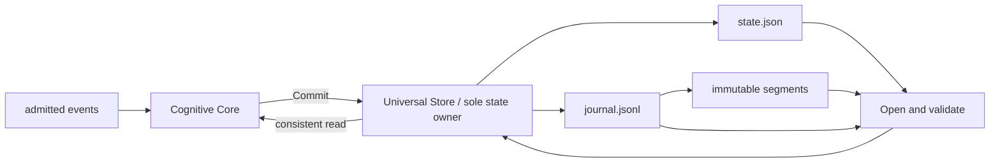

# M1.3 Foundation state map

## Current state structures

The active Universal Store implementation lives in `internal/foundation/statestore`; `internal/cognitivecore` retains a compatibility adapter and cognitive V3-to-V1 projection.
`Core` is the only normal writer of committed cognitive state; the service
coordinates resident operations, erase requests, and action delivery through
the same store. No consumer receives the internal maps.

| State | Data | Class | Current owner and readers | Writers / mutation path | Persistence and lifecycle | Proposed owner |
| --- | --- | --- | --- | --- | --- | --- |
| Store revision | `uint64` | Authoritative | Universal Store; Core, CoreV3, API and tests read via `Revision` | `Commit`; reset retains current revision | `state.json` and journal revision; monotonic during normal operation | Foundation StateStore |
| Current V1 snapshot | `CognitiveSnapshot` | Authoritative materialized view (rebuildable) | Universal Store; Core reads it to compose the next context; API reads serialized projection | `Commit`, journal replay, erase | JSON in `state.json`; repeated in each journal commit; restored from both sources | Intelligence domain type; future StateStore may store it through a compatibility boundary |
| Current V3 snapshot | optional `*CognitiveSnapshotV3` | Derived materialized view | Universal Store; CoreV3 and API read | V3 `Commit`, replay, erase | Optional `snapshot_v3` field in `state.json`; V3 contract remains versioned | Intelligence domain type; future StateStore may store it through a compatibility boundary |
| Commit journal | `[]Commit` bounded in-memory; archived segments on disk | Authoritative audit | Universal Store; API, action correlation, replay and qualification harnesses read copies | `Commit`, compaction and retention | `journal.jsonl` plus sorted `segments/*.jsonl`; `universal-store/v1`; erase removes both | Foundation StateStore and Persistence |
| Decision history | `[]Decision` | Derived projection | Universal Store; Core service and API read copies | Appended from each commit, bounded to 512 | Materialized `state.json`; rebuilt from journal commits when replayed | Foundation StateStore |
| Action outbox | `[]ActionRequest` | Authoritative pending work | Universal Store; Core action dispatcher and tests read copies | Commit adds; claim/ack update claim state | `state.json`; bounded to 128; request IDs make delivery idempotent | Foundation StateStore |
| Processed event IDs and order | map plus order slice | Authoritative deduplication metadata | Universal Store; Core duplicate detection | Successful commit; capped at 1024 IDs | Sorted IDs in `state.json`; replay restores then applies newer records | Foundation StateStore |
| Claimed action IDs | `map[string]struct{}` | Authoritative delivery metadata | Universal Store; dispatcher | `ClaimPendingActions`, `AcknowledgeAction` | Sorted IDs in `state.json`; reset on erase | Foundation StateStore |
| Resident gallery records | `map[string]foundation/contracts.ResidentGalleryRecord` (cognitivecore compatibility alias) | Authoritative redacted metadata | Universal Store; Core resident RPC and Discovery-facing service | Create, delete, rollback | `state.json`, identity-free records only; validated at open | Foundation contract extracted in M1.3.1; CRUD remains with Store; biometric material remains Vision-owned |
| Resident idempotency index | `map[string]string` keyed by SHA-256 | Authoritative operation metadata | Universal Store; resident RPC | Create operation; no raw idempotency key is stored | `state.json`; checked for hash shape and referential integrity at open | Foundation StateStore |
| Persistence path | cleaned directory string | Configuration | Universal Store | Set once by `OpenUniversalStore` | Runtime path currently derives from configured state path plus `universal-store` | Foundation Persistence configuration |
| Persistence hooks | `PersistenceHooks` callbacks | Model/test internal | Store fault-injection tests | `SetPersistenceHooks`; no production caller | Never serialized; hooks are nil in production | Test-only seam |

The cognitive facts in snapshots are derived from admitted events, but the
latest normalized snapshot is also the authoritative materialized context used
to process the next event. The journal is the recovery source; `state.json`
keeps restart and inspection efficient. Neither is a substitute for the
versioned snapshot contracts.

## Mutation, synchronization, and lifecycle

All in-memory maps, slices, revision and snapshots are protected by one
`sync.RWMutex` owned by `UniversalStore`. `Commit`, resident mutations, action
claims/acknowledgements, compaction, and erase hold the write lock across their
state transition and persistence operation. Reads use a read lock and return
copies or normalized values. This gives each in-process snapshot a consistent
view and serializes revision assignment with journal append.

The existing detachment is shallow for some compound records: `Journal` and
`Decisions` copy their outer slices, `SnapshotV3` copies the outer value, and
`Commit` retains nested payload maps and decision pointers. Current production
consumers treat these values as read-only, but the Go API does not make every
nested reference immutable. `SetPersistenceHooks` is also a test seam expected
to be configured before concurrent use. M1.3 preserves these existing
semantics; the race run below covers exercised code paths and does not establish
race freedom for callers that mutate returned nested values concurrently.

`Commit` appends and syncs the WAL record before applying the change in memory,
then atomically replaces `state.json`. If the process stops after the WAL sync,
opening the store replays the commit. If state replacement fails after the
in-memory update, the caller receives an error while the durable WAL remains
the recovery source; retrying the same event in that process is deduplicated.
Resident create/delete/rollback restore their previous in-memory value when
state persistence fails. Action claim/ack mutations currently update the
in-memory claim set before saving it and do not roll that set back on a save
error. These are existing transaction semantics and are intentionally not
changed here.

`OpenUniversalStore` loads `state.json`, validates its schema and resident
metadata, replays newer WAL records, validates archived segments and checks
bounds. There is no cross-process file lock; runtime composition currently
starts one Core owner for the configured store directory.

## M1.3.2 implementation boundary

The authoritative maps, mutex, revision, commit lifecycle, resident gallery
CRUD, serialization, WAL, compaction, restore, replay, erase and validation
now live in `internal/foundation/statestore`. The compatibility-facing
`cognitivecore.UniversalStore` contains one pointer to the Foundation Store
and delegates state operations. It performs only cognitive snapshot
normalization/validation and V3-to-V1 projection before typed commits.
`internal/foundation/persistence` continues to own atomic state-file
replacement.

The resident record remains a Foundation contract from M1.3.1. Snapshot and
decision records remain Intelligence domain types supplied to the Store as
compile-time generic parameters. See `26-universal-store-extraction.md` and
`27-foundation-store-contracts.md` for the boundary details.
