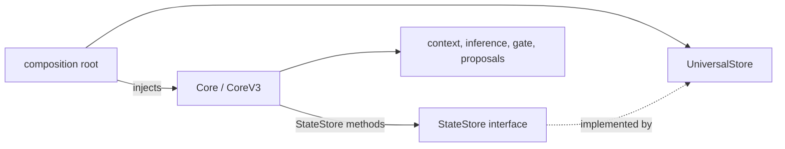

# M1.3 cognitive boundaries

## Implemented interface

`internal/cognitivecore/core.go` defines `StateStore` next to its consumers.
The interface gives `Core` and `CoreV3` controlled operations for reading the
current snapshot and revision, committing a typed record, reading history,
validating bounds, erasing state, and performing the resident-gallery state
transitions needed by the existing service. The concrete
`*UniversalStore` satisfies this interface and is injected through `Core.State`
and `CoreV3.State` in new composition code. The existing concrete `Store`
fields remain as compatibility fallbacks for older struct literals.

The Core continues to own context construction, temporal reasoning, evidence
interpretation, encoding, inference, safety gating and decision proposals.
The interface does not expose maps or internal slices. Existing processors
still use the same snapshot schemas, encoders, MLP backends and decision
algorithms.

## Store implementation boundary

The authoritative Store implementation lives in
`internal/foundation/statestore`. `Core` and `CoreV3` continue to use the
explicit `StateStore` interface, and the composition root continues to open
the Store through the source-compatible `cognitivecore.OpenUniversalStore`
adapter. The adapter owns cognitive snapshot validation/projection; Foundation
owns synchronization, revision assignment, persistence, journal/replay,
resident state, outbox state, compaction and erase.

The strongly typed Foundation Store accepts Intelligence-owned records via
generic compile-time constraints and does not import cognitivecore. The
remaining cognitive package is assigned to the Intelligence module. Details
and validation evidence are in `26-universal-store-extraction.md` and
`30-m132-validation.md`.
