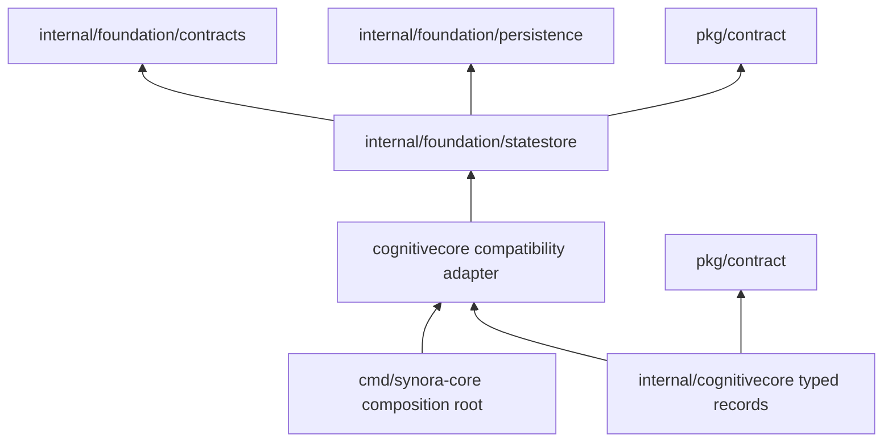
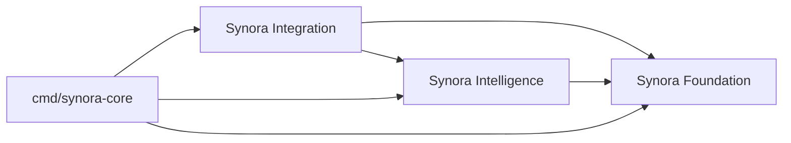

# M1.3.2 Foundation dependency graph

## Actual Go package edges

The architecture checker reads `go list` imports, validates package ownership,
and rejects package cycles, forbidden directions and undeclared module edges.
The Store-related package edges are:

`internal/foundation/statestore` and `internal/foundation/persistence` are
Foundation-owned. `internal/cognitivecore` is Intelligence-owned. Foundation
statestore receives cognitive record types through compile-time generic type
arguments and does not import Cognitive Core. Foundation contracts retain
standard-library-only imports. The composition root continues to open the
store through `cognitivecore.OpenUniversalStore` for source compatibility.

## Declared module dependencies

Foundation owns the authoritative Store. Intelligence depends on Foundation
for state operations and shared contracts. Integration directly uses
Cognitive Core and therefore declares Intelligence as a required module
dependency in addition to Foundation. The architecture checker validates the
actual package edges against these declarations.

The seven existing logical modules remain unchanged. The package ownership
registry assigns `internal/foundation/statestore` to Foundation and
`internal/cognitivecore` to Intelligence. No Foundation-to-Intelligence edge,
new Go module, process boundary, database, or plugin mechanism was introduced.
