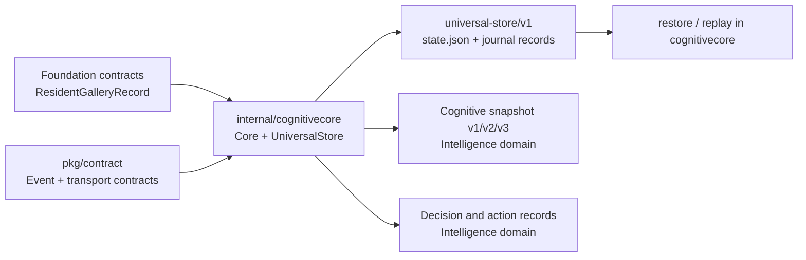

# M1.3.1 persistent contract inventory

## Scope and ownership terms

This inventory records implemented Go structures that cross the Store,
runtime, or persistence boundary. JSON tags below are the source of truth for
disk names. Types without tags are not independently persisted unless they
are embedded by a persisted record. “Proposed owner” describes the target
boundary after the future Store split; it does not claim that the Store moved
in M1.3.1.

| Type | Source / current package | Fields, serialization, readers and writers | Classification and owner |
| --- | --- | --- | --- |
| `ResidentGalleryRecord` | `internal/foundation/contracts`; compatibility name in `internal/cognitivecore/resident_gallery.go` | `ResidentRef string` (`resident_ref`), `GalleryStatus string` (`gallery_status`), `Generation uint64` (`gallery_generation`), `PolicyVersion string` (`policy_version`), `ErrorCategory string` (`last_error_category,omitempty`), `Deleted bool` (`deleted,omitempty`), `CreatedAt/UpdatedAt time.Time` (`created_at`/`updated_at`). Read by resident RPC and gallery coordination; written by resident create/delete/rollback; stored in `state.json`. `Validate` checks opaque ref, status, policy, redaction and timestamps. | **FOUNDATION_CONTRACT**, physically extracted. Foundation owns the definition and validation; Store owns CRUD and persistence. |
| `ActionRequest` | `internal/cognitivecore/store.go` | `SchemaVersion`, `RequestID`, `EpisodeID,omitempty`, `Action ActionIntent`, `DryRun`, with snake_case JSON tags. Written into commit/action outbox; read by Core dispatcher and Store recovery. | **PERSISTENCE_WIRE_RECORD** coupled to Intelligence `ActionIntent`; retained in cognitivecore to preserve Go API and action semantics. Distinct from transport `pkg/contract.ActionRequest`. |
| `Commit` | `internal/cognitivecore/store.go` | `Event contract.Event`, `Snapshot CognitiveSnapshot`, `SnapshotV3 *CognitiveSnapshotV3,omitempty`, `Decision Decision`, `DecisionV3 *DecisionV3,omitempty`, `Action *ActionRequest,omitempty`, `CommittedAt time.Time`, all tagged. Written by Core; read by replay, history, APIs and qualification harnesses; embedded in journal records. | **PERSISTENCE_WIRE_RECORD** containing Intelligence domain values and shared Event. Retained. |
| `CommitResult` | `internal/cognitivecore/store.go` | `Revision uint64`, `Duplicate bool`, `Action *ActionRequest`; exported Go result, not independently JSON-tagged. Returned by `UniversalStore.Commit`, consumed by Core. | **INTERNAL_IMPLEMENTATION** result coupled to cognitive `ActionRequest`; retained with Store API. |
| `storeDiskState` | `internal/cognitivecore/store.go` | Private tagged JSON envelope: `SchemaVersion`, `Revision`, `Snapshot`, optional `SnapshotV3`, `Journal`, `Decisions`, `ActionOutbox`, `Processed`, `Claimed`, optional `Residents`, optional `ResidentIdempotency`. Encodes `universal-store/v1` in `state.json`; read by `OpenUniversalStore`, written by `persistStateLocked`. | **PERSISTENCE_WIRE_RECORD** / implementation envelope; private to Store and retained. |
| `storeJournalRecord` | `internal/cognitivecore/store.go` | Private tagged JSON `SchemaVersion`, `Revision`, `Commit`; one per `journal.jsonl` and archived segment line. Written by WAL append/compaction; read by restore/replay/history. | **PERSISTENCE_WIRE_RECORD**, private to Store and retained. |
| `SecurityFacts` | `internal/cognitivecore/snapshot.go` | `Armed`, `Degraded`, `Known bool`; JSON names unchanged. Embedded in V1/V2 cognitive snapshots. Produced by Core projection; read by encoders and decision runtime. | **INTELLIGENCE_DOMAIN_TYPE**; values have cognitive meaning and feed a fixed model vector. |
| `PresenceFacts` | same | `HumanPresent`, `KnownResidentsPresent`, `TrackConfirmed bool`; `KnownResidentCount`, `TrackCount int`; snake_case tags. Embedded in V1/V2 snapshots. | **INTELLIGENCE_DOMAIN_TYPE**; kept with snapshot normalization/encoding. |
| `CapabilityFact` | same | `Capability string`, optional `Topology string`, `Available bool`; JSON tags `capability`, `topology,omitempty`, `available`. Slice in V1 snapshot. | **INTELLIGENCE_DOMAIN_TYPE**; sorted/capped by cognitive normalization. |
| `SensorFacts` | same | `Movement bool`, `AccessState string`, `SensorEvidence bool`, `AlarmState string`, `ObservationCount int`, `Confidence float32`; all tagged. | **INTELLIGENCE_DOMAIN_TYPE**; cognitive normalization clamps and canonicalizes values. |
| `EpisodeFacts` | same | `Phase string`, `SegmentCount/GapCount int`, `SecondsSinceFirst/SecondsSinceLast/CalmSeconds float32`; all tagged. | **INTELLIGENCE_DOMAIN_TYPE**; model input semantics. |
| `ActionResultFact` | same | `Status string`, `Successful/Failed/Unavailable bool`; all tagged. Slice in V1 snapshot. | **INTELLIGENCE_DOMAIN_TYPE**; feeds cognitive outcome features. |
| `CognitiveSnapshot` | same | `SchemaVersion string`, `Revision uint64`, `CapturedAt time.Time`, nested facts above, `Topology string`, `Capabilities []CapabilityFact,omitempty`, `PreviousDanger float32`, `PreviousDangerKnown bool`, `ActionResults []ActionResultFact,omitempty`, fixed `[VisionEvidenceSize]float32`; JSON tags on every field. `Normalized`, `Validate`, and `CanonicalJSON` define persisted semantics. Written by Core/Store and consumed on restore, replay, API and V1 encoder. | **INTELLIGENCE_DOMAIN_TYPE** despite persistence. Moving it would also move or duplicate normalization, validation, topology vocabulary and feature semantics. Retained. |
| `VisionSignalsV2`, `CommunicationCapabilitiesV2`, `CognitiveSnapshotV2` | `internal/cognitivecore/snapshot_v2.go` | V2 vision aggregates (availability, pose/fall/risk/identity and quality flags), communication availability/status/cooldown, and snapshot metadata/base facts. All serialized fields use explicit snake_case tags; `CognitiveSnapshotV2` carries `cognitive-snapshot/v2`. Written/read by V2 qualification and encoder paths; V3 nests V2 as `base_v2`. | **INTELLIGENCE_DOMAIN_TYPE**; versioned feature and qualification semantics remain cognitive-owned. |
| `VisionSignalsV3`, `CognitiveSnapshotV3`, `VisionEvidenceProjectionV3` | `internal/cognitivecore/snapshot_v3.go` | V3 vision aggregate fields are explicitly tagged; snapshot stores schema/revision/time, `BaseV2`, vision, simulation/status/source/inference markers, optional `*contract.VisionEvidenceV1`, and projection (`NotEncodedInSnapshotV3`, `Facts,omitempty`). Store persists the optional snapshot; V3 Core and encoder consume it. | **INTELLIGENCE_DOMAIN_TYPE**; retained with V3 projection and evidence mapping behavior. |
| `ActionIntent`, `ActionAssessment`, `Decision`, `DecisionV3`, `CommunicationIntentV3`, `CommunicationAssessmentV3` | `internal/cognitivecore/decision.go`, `decision_v3.go` | Decision records have explicit tags including schema/status/mode/source, model outputs, optional trace/latency/errors, action assessment, and generated time. `ActionIntent` is action/topology/optional capability. V3 adds communication intent, capability/status/reasons/rendered text/audio result. Store journals and materializes decisions; Core, API and dispatcher consume them. | **INTELLIGENCE_DOMAIN_TYPE** embedded by persistence. Action proposals, gates and dry-run semantics are cognitive policies, so not Foundation contracts. |
| `MLPOutput`, `MLPTrace`, topology/activation/path records; `MLPOutputV3`, manifests and model artifact records | `internal/cognitivecore/decision.go`, `decision_v3.go` | Tagged model inference, trace, topology, labels, artifact hashes and latency structures. `Decision.Trace` may persist redacted trace; manifests/artifacts are model-loader inputs, not Store state. | **INTELLIGENCE_DOMAIN_TYPE** or model implementation records; retained. |
| `contract.Event` | `pkg/contract` | Shared event envelope consumed by Core, bus and Store journal; its existing event/action contract and tags are not changed here. | **SHARED_EXTERNAL_CONTRACT**, already Foundation-owned; no duplicate introduced. |
| `contract.ActionRequest` | `pkg/contract` | Existing transport action request with its own field set and tags. Consumers are transport/adapters. | **SHARED_EXTERNAL_CONTRACT**, distinct from cognitive Store `ActionRequest`; no alias or merge. |
| `CompactionOptions`, `StoreDiskReport`, `PersistenceHooks`, `UniversalStore` | `internal/cognitivecore/store.go` | Store options and diagnostics are not the durable event schema. Hooks are test-only and are never serialized. `UniversalStore` owns private maps/slices, locks, path and replay implementation. | **INTERNAL_IMPLEMENTATION**; explicitly retained in this milestone. |
| `storeDiskState.ResidentIdempotency` and private resident maps | `internal/cognitivecore/store.go` | `map[string]string` from SHA-256 operation-key hash to opaque resident ref; state envelope tags preserve omission behavior. `validateResidentGalleryState` checks hashes/references. | **INTERNAL_IMPLEMENTATION** metadata. Record value is now a Foundation contract; indexing and mutation stay Store-owned. |

## Versioned formats and readers

The active Store envelope is `universal-store/v1`. It contains the V1
snapshot schema `cognitive-snapshot/v1`, optional V3 `cognitive-snapshot/v3`,
decision schemas `cognitive-decision/v1` and the V3 decision record, action
outbox entries, event journal and resident records. Snapshot V2 is a cognitive
qualification format and V3's nested base; it is not a new Store envelope.
Each journal line and archived segment entry uses `storeJournalRecord` with
`universal-store/v1`. Replay restores events and cognitive values through the
existing cognitivecore validators.

`state.json`, `journal.jsonl`, `segments/*.jsonl`, and `erase.marker` are read
and written only by the existing Store. Readers reject malformed JSON,
unsupported Store schemas, invalid resident metadata, invalid journal lines,
and invalid archived segments with errors. No on-disk version changed here.

## Shallow-copy audit

The Store's `Journal`, `Decisions`, and `ActionOutbox` methods copy the outer
slice under the read lock. `History` returns a newly collected slice but its
embedded commits retain nested slice/map/pointer references. `Snapshot` calls
`Normalized`, which copies capability/action-result slices, while the optional
V3 snapshot accessor returns a value whose nested evidence pointer/slices may
remain shared. `CommitResult.Action` also returns a pointer to an action record.
These APIs can expose mutable nested references after the lock is released.
Current production callers treat the values as read-only; synchronization and
copy depth are unchanged in M1.3.1. Deep-copy design and focused mutation
tests remain an M1.3.3 recommendation.

## Ownership diagram

## M1.3.2 ownership update

The Store types previously classified as implementation in
`internal/cognitivecore/store.go` now live in
`internal/foundation/statestore/store.go`. Cognitive snapshots, decisions and
action requests remain Intelligence domain types; Foundation holds their exact
types through generic parameters rather than duplicating their persisted
representations. `UniversalStore` in cognitivecore is now only the compatibility
adapter. Resident CRUD and index validation also moved into Foundation
statestore; the resident record remains the Foundation contract from M1.3.1.
