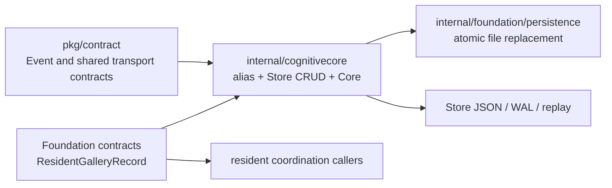
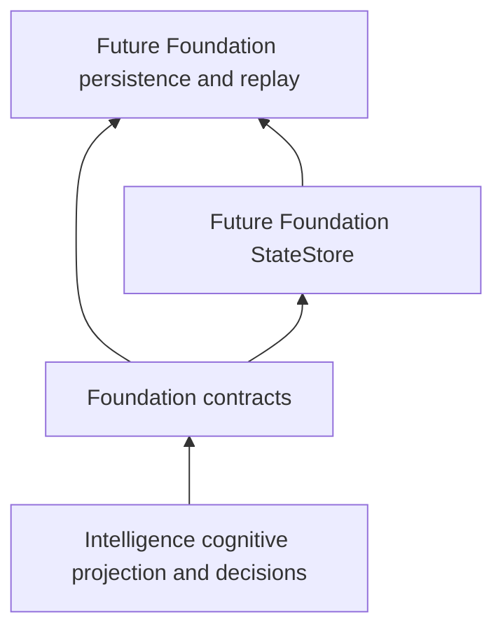

# M1.3.1 persistent contract boundaries

## Implemented extraction

`internal/foundation/contracts` is a Foundation-owned Go package for stable,
identity-free records shared between state ownership and resident/gallery
coordination. It currently defines `ResidentGalleryRecord`, its policy
version, validation method, and opaque-reference validation. It imports only
the Go standard library. It contains no Store CRUD, filesystem operations,
Vision implementation types, or cognitive processing.

`internal/cognitivecore.ResidentGalleryRecord` is a source compatibility type
alias to the Foundation definition; `ResidentGalleryPolicyVersion` is a
constant alias. Existing `UniversalStore` methods and `Core.StateStore` method
signatures continue to use the historical package spelling. Since Go aliases
preserve type identity, existing struct literals, method sets (including
`Validate`), JSON tags and reflection type name resolve to the canonical
Foundation type. Reflection-sensitive callers can observe the canonical
type's changed `reflect.Type.PkgPath` (now
`synora/internal/foundation/contracts`); no in-workspace caller relies on the
old package path, but external callers that inspect it would observe the move.
This was evaluated for this record only; it is not a general claim that moving
arbitrary named Go types is source or reflection safe.

The actual package ownership registry and Foundation descriptor now include
`internal/foundation/contracts`. The architecture checker checks that this
package is Foundation-owned, allows it only standard-library imports, and
continues to check observed module edges, forbidden directions and cycles.
`pkg/contract` remains the home of existing shared transport contracts. No
duplicate Event or action request was added.

## Deliberately retained types

`Commit`, `ActionRequest`, `Decision`, `DecisionV3`, and `CognitiveSnapshot`
remain in `internal/cognitivecore`. Their fields encode cognitive proposals,
model outputs, safety-gate outcomes, normalization rules, feature ordering,
and Intelligence-specific V1/V2/V3 schemas. Their persistence does not make
them general Foundation contracts. The Store's private `storeDiskState` and
`storeJournalRecord` envelopes also remain beside the implementation that
reads, validates, writes, compacts and replays them.

The Universal Store, StateStore method interface, JSON serializers, snapshot
normalizers, journal append/replay, erase behavior and persistence policy
remain in `internal/cognitivecore`. Only the independent resident metadata
record moved. This is a real extraction, but does not claim full
Foundation/Intelligence isolation or prepare a Store move by itself.

## Current ownership discrepancy found

Before this milestone, `modules/intelligence.json` described the cognitive
processing/store source as co-located, while `modules/package-ownership.json`
assigned all of `synora/internal/cognitivecore` to Foundation. The actual
`StateStore` interface also lives in `internal/cognitivecore`; there is no
separate Intelligence StateStore Go package. The descriptor now states that
the package remains Foundation-owned during the compatibility phase. The
abstract module dependency remains a declared target capability and must not
be read as evidence of a source package move.

## Contract ownership rules

- Foundation contracts are semantic records that at least one independent
  module boundary needs and that do not encode Intelligence-only policy.
- A disk envelope is a persistence wire record when its field shape is
  controlled by Store recovery/serialization, even if exported or embedded.
- Cognitive snapshots and decisions remain Intelligence domain types when
  normalization, vocabulary, feature ordering, safety policy, or model
  semantics are part of their behavior.
- Compatibility aliases stay documented and temporary. Any future removal
  requires a separate API compatibility decision.

## Future target (not implemented)

The future graph requires stable contracts for journal commits, snapshots,
decisions and action work. M1.3.1 does not define parallel persistence types
or adapters for those records because that would create duplicate
authoritative representations before their compatibility and ownership
boundaries are agreed.

## M1.3.2 implementation extraction update

The Future target described above is implemented for the Store mechanism:
Foundation statestore owns state, journal/replay, serializers and persistence
calls; Cognitive Core supplies its existing typed records and retains V3
projection. Its compatibility adapter preserves the historical API. This
avoids duplicate wire contracts and keeps Foundation free of Intelligence
imports. See `26-universal-store-extraction.md` for the realized dependency
flow and `29-store-compatibility.md` for the observable alias/reflection limit.
