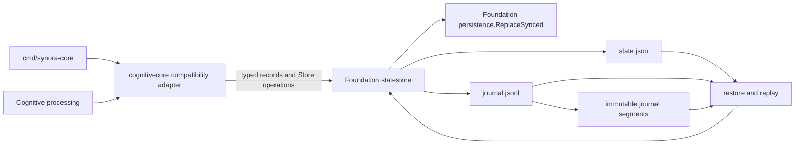

# M1.3.2 Universal Store extraction

## Result

The authoritative Universal Store implementation now lives in
`internal/foundation/statestore`. The package owns the mutex, revision,
materialized snapshots, bounded journal/decision/outbox state, event
idempotency, resident gallery state and index, filesystem path, state JSON,
WAL append, archive rotation/retention, restore, replay, erase recovery,
action claim/acknowledgement, and bounds checks.

`internal/cognitivecore.UniversalStore` is a compatibility adapter containing
only a pointer to the typed Foundation Store. Its constructors, exported
methods, `Commit`, options/report/hooks, record spellings, and resident gallery
methods preserve the existing call surface. The adapter owns only the
Intelligence-specific V3-to-V1 projection and pre-commit cognitive snapshot
normalization/validation. Core reasoning, inference, decisions, action policy,
and snapshot domain types remain in Cognitive Core.

## Typed boundary

The Foundation package uses Go generic record parameters with compile-time
constraints for normalized/validated/revisioned snapshots and stable action
IDs/dry-run state. `Commit`, disk state, and journal records retain the
concrete record types. There is no `any` payload storage, reflection-based
codec, JSON raw-message envelope, or Foundation import of Cognitive Core.
Cognitive Core supplies its existing record types to the adapter; their
persisted JSON tags and schemas remain unchanged.

Foundation depends on `internal/foundation/contracts` for the resident record,
`internal/foundation/persistence` for synced state-file replacement, and
`pkg/contract` for the event envelope. It does not import Intelligence,
Vision, Integration, or Platform packages. The module hierarchy is unchanged.

## Persistence and compatibility

The adapter normalizes and validates the existing snapshot values and
projects V3 to the existing V1 materialized snapshot before calling
Foundation. Foundation assigns revisions, applies dry-run to action outbox
records, appends and syncs `universal-store/v1` WAL records, applies the commit,
and replaces `state.json`. Restore continues to decode the same state fields,
replay only newer records, validate segments and bounds, and recover the erase
marker. No path, schema version, migration, database, process, or entrypoint
was added.

The `cognitivecore` Go API remains available for source compatibility. As with
the M1.3.1 resident type alias, `Commit` and `CommitResult` are aliases to
concrete generic Foundation instantiations, so reflection reports the
Foundation package path for those types. This is an observable reflection
change; ordinary source use, field shape, JSON tags, and method behavior are
preserved. A caller depending on `reflect.Type.PkgPath` is outside the
compatibility evidence collected here.

## Ownership and module graph

`internal/foundation/statestore` is Foundation-owned. The remaining
`internal/cognitivecore` package is Intelligence-owned. Integration declares
its existing direct use of Cognitive Core as a required Intelligence module
dependency. Foundation does not depend on Intelligence. The package ownership
registry, module descriptors, and architecture checker agree on these
assignments; see `20-foundation-dependency-graph.md` and
`30-m132-validation.md`.
