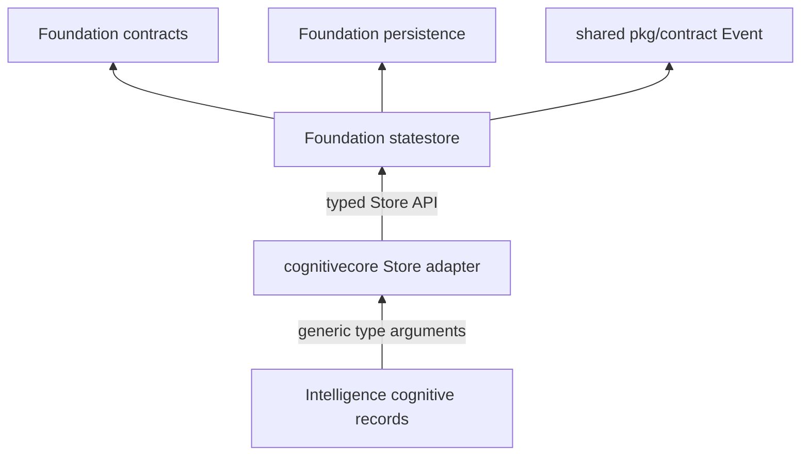

# M1.3.2 Foundation Store contracts

## Runtime record ownership

The Store is domain-neutral in its implementation while retaining strongly
typed record instantiations. `statestore.SnapshotRecord[T]` requires
normalization, validation, revision assignment, and revision inspection.
`statestore.ActionRecord[T]` requires dry-run assignment and a stable request
ID. The Foundation `Commit`, `CommitResult`, disk state, and journal record
carry the exact generic types supplied by the compatibility adapter.

Cognitive Core remains the owner of `CognitiveSnapshot`,
`CognitiveSnapshotV3`, `Decision`, `DecisionV3`, and `ActionRequest`. The
snapshot types implement the small revision operations required by Foundation;
ActionRequest implements stable ID and dry-run operations. These methods do
not alter serialization or cognitive policy. `Decision` values remain typed
records; the Store does not inspect their contents.

`ResidentGalleryRecord` remains a Foundation contract extracted in M1.3.1.
Foundation statestore owns resident CRUD, idempotency hashing/index validation,
and persistence. Cognitive Core keeps source-compatible aliases and delegates
its methods.

## Dependency boundary

The type-parameter constraints describe operations, not alternate serialized
contracts. The Store retains typed values throughout the in-memory state and
JSON codec. No generic map of arbitrary data, dynamic registration, plugin
loading, or Foundation-to-Intelligence import is introduced.
