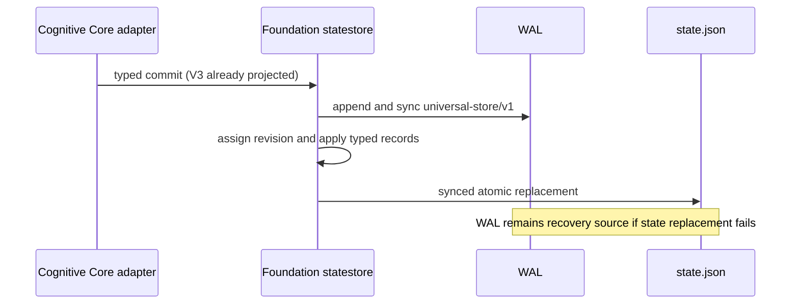

# M1.3.2 journal and replay boundaries

## Foundation ownership

`internal/foundation/statestore` owns serialization of the existing
`universal-store/v1` state and journal records, WAL append and sync, immutable
segment reads and writes, compaction and retention, state restoration, replay,
revision assignment, event deduplication, erase-marker recovery, and durable
state replacement through `internal/foundation/persistence`.

The `cognitivecore` compatibility adapter handles the V3 snapshot validation
and projection into the existing V1 materialized snapshot. Foundation then
validates the supplied typed snapshots, assigns revisions, and persists the
commit. It does not interpret decisions or run cognitive processing.

## Existing lifecycle retained

1. Open creates the configured Store directory and restores `state.json` when
   present.
2. The existing `universal-store/v1` schema is checked; resident metadata is
   validated, and processed/claimed indexes are rebuilt.
3. Active WAL records newer than the materialized revision are replayed;
   malformed records fail open.
4. Archived segments are validated and included by `History`.
5. Commit syncs a WAL line before in-memory apply and state-file replacement.
6. Compaction persists state, rotates active WAL into an immutable segment,
   applies the configured retention policy, and syncs the directory.
7. Erase syncs its marker before deleting journal history, persists empty
   materialized state, removes the marker, and syncs the directory.

No persistence path, wire schema, field tag, timestamp representation,
retention default, or erase behavior was intentionally changed. The focused
Foundation tests exercise durable typed records, restart, duplicate handling,
and recovery from a WAL commit when state replacement fails. Existing
cognitivecore Store tests continue to exercise snapshots, resident state,
compaction, corruption handling, and interrupted erase through the historical
API.
