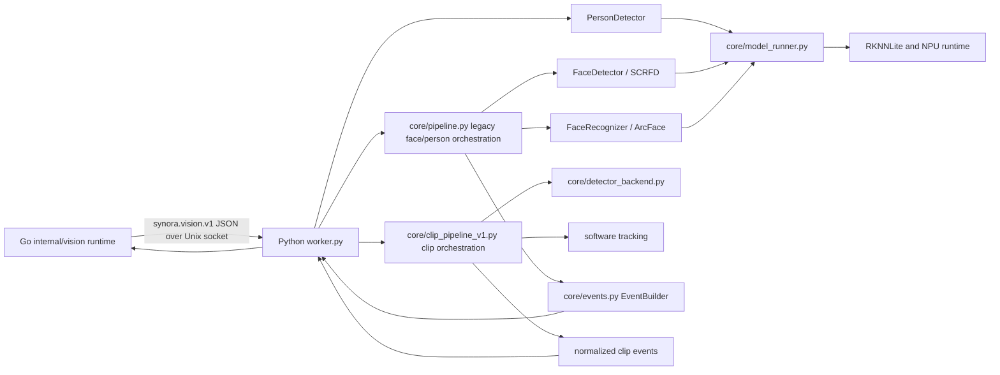
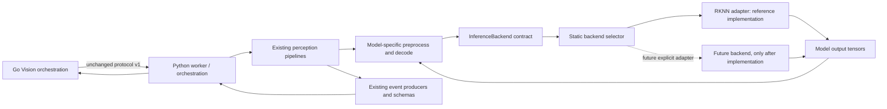

# M1.4 — Vision responsibility map

**Status:** IMPLEMENTED architecture extraction; current hardware execution remains RKNN-specific.  
**Scope:** Python Vision Worker and its existing Go orchestration boundary. No logical module, service, Go package owner, or event consumer moved.

## Existing pipeline

The existing models use different tensor semantics; their preprocessing and output decoding remain with each model stage. The clip detector adapter normalizes existing person detections but does not replace the model implementation.

## Responsibility inventory

| Responsibility | Current implementation and callers | Inputs / outputs and dependencies | State and hardware assumption | M1.4 ownership |
|---|---|---|---|---|
| VISION_PIPELINE | `core/pipeline.py:VisionPipeline`; worker; `core/clip_pipeline_v1.py:VisionClipPipelineV1`; worker | Frames/clip metadata to observations and aggregate results; uses model stages, trackers and enrichers | Per-stream and per-episode in-memory tracking; no direct RKNN type | Pipeline modules; backend-neutral interfaces above model stages |
| INFERENCE_BACKEND | `core/inference_backend.py:InferenceBackend`; model stages call factory | Tensor in to model output representation out; `infer`, `close`, metadata | Per-model runner resources | Explicit narrow protocol; implemented by statically selected adapter |
| MODEL_PREPROCESSING | `modules/detect/person_detector.py`, `modules/detect/face_detector.py`, `modules/face/FaceRecognizer.py`, pose adapters | Existing model-specific shapes/layouts/dtypes to tensor inputs | Per-call arrays; YOLO NHWC float32, SCRFD/ArcFace NCHW float32, YOLO pose NHWC uint8, RTMPose NCHW float32 | Remains beside each model stage; no universal preprocessor |
| MODEL_POSTPROCESSING | Same model stages; `core/rtmpose_backend.py`; `core/yolov8_pose_backend.py` | Runtime output tensors to detections, landmarks, embeddings or aggregate pose data | Thresholds and decoding remain model-specific | Remains beside each model stage |
| MODEL_LOADING | Previously `core/model_runner.py`; now `core/rknn_backend.py:RKNNInferenceBackend`, through `core/model_runner.py:create_model_runner` | Model path, metadata and runtime config to initialized runner or typed error | Existing `.rknn` files and RKNNLite | RKNN loading contained in concrete adapter |
| TRACKING | `modules/tracking/tracker.py`, `edge/tracker.py`, clip pipeline tracking | Detections/observations to track identities and temporal state | Software state scoped to pipeline/episode | Vision pipeline; no backend dependency |
| IDENTITY | `FaceRecognizer`; `core/pipeline.py`; face dataset manager | Face crop/embedding and resident snapshot to identity result | Face DB snapshot owned/installed by worker; fail-closed qualification flag remains | Vision model/identity stage; no runtime type crosses contract |
| EVENT_CONTRACT | `core/events.py:EventBuilder`, clip event normalization, Go Vision contract | Observations to existing event names and payloads | Event schema shared at worker boundary | Existing contracts and producer; unchanged |
| WORKER_TRANSPORT | `worker.py` socket loop; `internal/vision/runtime.go` | Newline-delimited JSON requests/replies over AF_UNIX | Existing socket path/configuration | Existing worker transport; unchanged |
| WORKER_LIFECYCLE | Go `WorkerLifecycle` and `worker_manager.go`; Python `VisionWorker.close` | Start/stop, process supervision, backend resources | Existing Go supervision/restart policy; Python closes model runners and detector executors | Go process lifecycle preserved; worker now closes owned inference resources |
| HARDWARE_ADAPTER | `core/rknn_backend.py`, NPU core masks, model paths and RKNN runtime format | RKNN model and target-specific config | RK3588/RKNPU2 assumptions remain explicit | Concrete adapter/config only |
| PLATFORM_DEPENDENCY | RKNNLite, OpenCV, NumPy, Linux Unix sockets | Native runtime and host libraries | Python importability does not establish device portability | Explicit platform/runtime dependency |

The concrete RKNN type previously entered `core/model_runner.py` and `worker.py` (for NPU core constants). It now appears only in `core/rknn_backend.py`. Model code still requests a configured runner through the factory, but does not import RKNN types. `core/model_runner.py` contains static selection and capability/status logic; it does not import the runtime package directly.

## Target pipeline

## What is implemented and what is not

- **IMPLEMENTED:** runner contract, model metadata, explicit RKNN adapter, static backend selection, adapter-owned core masks, idempotent model cleanup, injected runner factories.
- **TESTED:** deterministic fake runner through existing YOLO preprocessing, decode, clip detector normalization, and cleanup; existing model and worker tests.
- **MOCKED:** fake runner outputs verify wiring and output contracts only; they say nothing about model quality.
- **NOT_IMPLEMENTED:** production CPU/ONNX inference. ONNX Runtime and other inspected CPU inference packages were unavailable at baseline; no dependency was installed.
- **FUTURE_WORK:** another concrete backend and its matching model artifacts, device qualification, and comparable hardware performance measurements.
