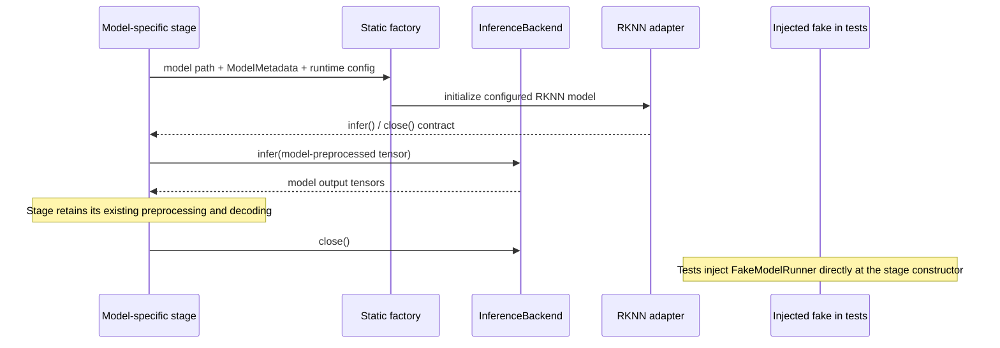

# M1.4 — Inference backend contract

**Status:** IMPLEMENTED, narrow in-process Python boundary. It is not a registry, service, or dynamic plugin system.

## Contract

`services/vision-worker/core/inference_backend.py` defines:

- `ModelMetadata`: model id/task, expected input shape, dtype and layout, output representation, required backend, target, and optional runtime data format.
- `InferenceRuntimeConfig`: requested backend, target, and optional backend-local core mask.
- `InferenceBackend`: `backend`, `metadata`, `infer(input_tensor)`, and `close()`.
- `ModelUnavailableError` and `ModelExecutionError`: structured failure codes, model path/id, and human-readable messages.

The compatibility factory in `core/model_runner.py` retains its existing positional `model_path`, `core_mask`, and `input_data_format` arguments. New model callers pass the model's metadata. `VISION_BACKEND=auto` resolves to the model's declared requirement, currently `rknn`. Unsupported choices fail closed. Selection is static; there is no module discovery or dynamic loading.

## Current model contracts

| Model stage | Input | Output representation | Existing stage behavior |
|---|---|---|---|
| YOLOv8 person | `[1,640,640,3]`, float32 NHWC | YOLO rows, channel-first `[1,84,8400]` or compatible row-major | RGB normalization, confidence 0.40, NMS 0.45, existing person filtering |
| SCRFD face | `[1,3,640,640]`, float32 NCHW | stride 8/16/32 scores and boxes, optional landmarks | Existing letterbox, confidence 0.15, NMS 0.40; wrapper max 10 and minimum size 30 |
| ArcFace embedding | `[1,3,112,112]`, float32 NCHW | normalized 512-dimensional embedding | Existing similarity thresholds 0.90 / 0.65 and worker fail-closed qualification |
| RTMPose | `[1,3,256,192]`, float32 NCHW | SimCC outputs | Existing aggregate-only pose adapter; does not establish a confirmed fall event |
| YOLOv8 pose qualification tool | `[1,640,640,3]`, uint8 NHWC | three DFL heads plus pose head | Qualification/advisory path; not enabled as a general production model |

The metadata documents tensor semantics; it does not perform model conversion or force shared preprocessing. RKNN runtime `data_format` is passed only where the existing YOLO stage already specifies `nhwc`. The adapter uses `numpy.ascontiguousarray`, which returns a view/reference for an already contiguous input and copies only when needed.

## Capability states

Model status keeps legacy `status/path/error` fields and adds `support_state`, `configuration_state`, `availability_state`, `backend`, `target`, and metadata. `SUPPORTED` means a statically implemented adapter declares the model requirement. `CONFIGURED` means a model file is present at the configured path. `AVAILABLE` means that component actually initialized. Those are separate facts; declared support is not runtime availability.

## Substitution and ownership

**IMPLEMENTED:** RKNN reference implementation and constructor injection points.  
**TESTED:** deterministic fake executes through the person detector and existing detector normalization, including cleanup and inference failure handling.  
**MOCKED:** generated arrays only; no neural inference is represented.  
**NOT_IMPLEMENTED:** production CPU/ONNX backend; no suitable runtime was found and no package was installed.  
**FUTURE_WORK:** an adapter can be added only with matching model artifacts and explicit capability and hardware tests.
