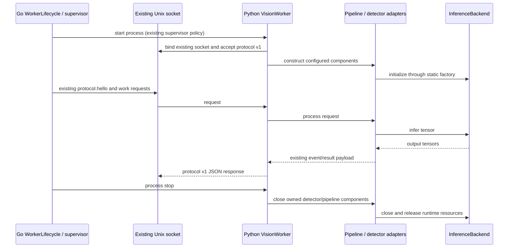
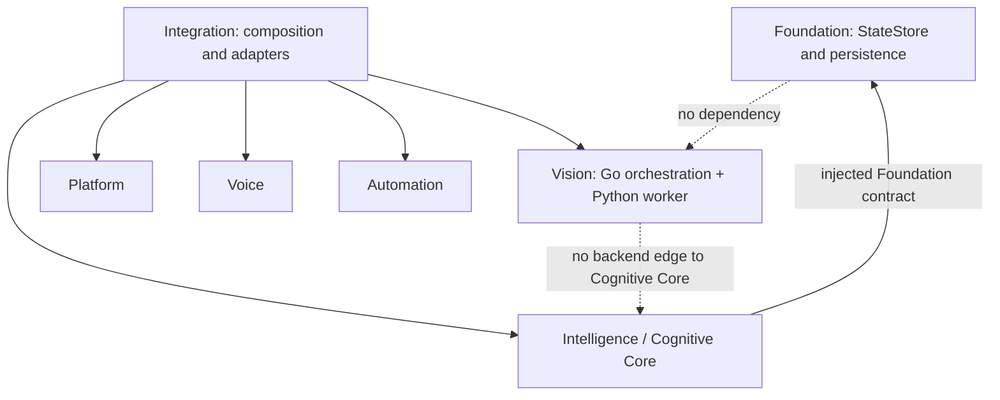

# M1.4 — Vision runtime isolation

**Status:** IMPLEMENTED for inference runtime types and worker resource cleanup. Hardware use remains Rockchip-specific through the reference adapter.

## Extraction

`core/rknn_backend.py` owns the only production Python import of `rknnlite`, runtime construction, model loading, runtime initialization, inference, output shape logging, NPU core-mask constants, and `release()`. `core/model_runner.py` owns static selection, compatibility factory arguments, and capability status. The perception pipeline does not receive an RKNN runtime object or NPU enum.

Each model stage continues to own its own preprocessing and decoding because the existing models do not share one tensor layout. The processing graph, software tracking, face identity thresholds, event production, and worker IPC are retained. No production CPU adapter was added.

## Worker lifecycle

Go process management and its injected `WorkerLifecycle` remain unchanged. Python `VisionWorker.close()` is called from `finally` around the existing worker entrypoint and releases detector executors and unique model components. Detector wrappers close the underlying detector and runner; cleanup errors are logged at worker scope.

## Actual module dependencies

The seven logical modules and Go package ownership remain unchanged. The architecture checker continues to enforce Go module edges and now additionally parses Python imports to require that `rknnlite` imports remain in `core/rknn_backend.py` only. This check is deliberately limited to one concrete runtime boundary.

## Remaining platform assumptions

- RKNNLite and an RK3588/RKNPU2-compatible runtime/model are required for the current real models.
- NPU core fan-out uses RKNNLite constants, now obtained only through the adapter.
- Existing model paths remain configuration inputs; this milestone does not alter production paths or deploy hardware configuration.
- `cv2`, NumPy, Linux AF_UNIX sockets, and the worker process remain platform dependencies.
- **NOT_IMPLEMENTED:** hardware-independent production inference. Python import success alone does not establish portability.
- **TESTED:** backend substitution with fake runner; actual RK3588 model quality, throughput, and device lifecycle were not qualified in this run.
