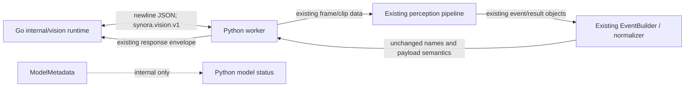

# M1.4 — Vision contract compatibility

**Status:** Existing worker transport and event semantics preserved. This change adds internal model metadata and does not change the Go/Python wire protocol.

## Worker IPC

The Go runtime continues to communicate with `services/vision-worker/worker.py` over the configured AF_UNIX socket (default `/run/synora/vision-worker.sock`). The protocol identifier remains `synora.vision.v1`; messages remain newline-delimited JSON. The worker still requires `protocol.hello` before processing work. Existing clip, segment, edge, episode-release, and enrichment request handling remain in place. The Go `WorkerLifecycle` abstraction and process supervisor were not modified.

The protocol identifier, hello envelope, request/response operations, and event fields are unchanged. Existing `models` capability entries now carry additive metadata and separate support/configuration/availability fields; Go consumers continue to receive the existing model map. No request or event schema changed.

## Event compatibility

The EventBuilder's existing allowed names remain: `vision.identity`, `vision.unknown`, `vision.uncertain`, `vision.motion`, `vision.weapon`, `vision.fall`, and `vision.tamper`. Existing camera/device/scene/timestamp and confidence payload semantics remain owned by the event producer and Go contracts. This change does not add event types or convert pose candidates into confirmed falls.

## Model behavior retained

Preprocessing, output interpretation, confidence thresholds, NMS, face similarity thresholds, tracking, event timing, and payload normalization remain in their existing model/pipeline modules. The injected fake is supplied at a constructor/factory seam and exercises these same stages; it does not replace any event contract.

**TESTED:** Existing worker IPC and event tests remain in the suite; the final validation record reports complete counts. The fake detector test checks the normalized `human` detection, confidence, and timestamp path.  
**MOCKED:** Model outputs are deterministic arrays.  
**NOT_CHANGED:** Cognitive Core consumers, Foundation ownership, Go runtime composition, service/socket configuration, and event schema.  
**LIMITATION:** This was compatibility validation within existing tests, not a live service or production-camera test.
